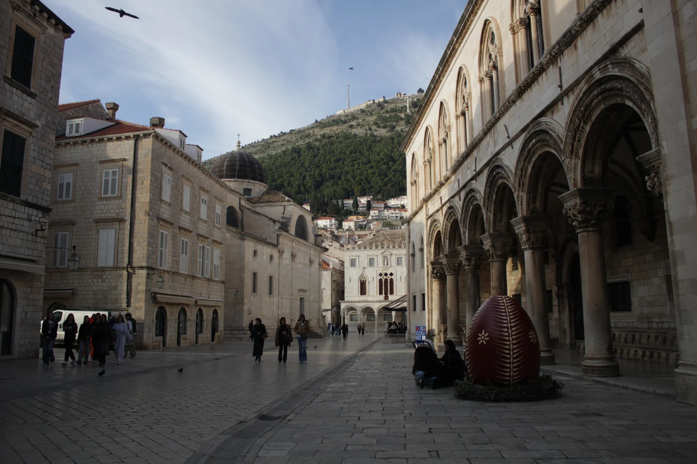

# Aprender mirando mis fotos

Un editor crítico para aprender fotografía a partir de fotos propias.

**Estado: en pruebas.**

## Qué quería hacer

Quiero un editor crítico de fotos que me ayude a aprender con las imágenes que saco. Que pueda hablar del encuadre y del momento, explicar decisiones técnicas y proponer algo concreto para la próxima salida.

## Qué probé

La primera revisión trabaja sobre una serie de fotos de los Balcanes. Separa la lectura visual de las fichas técnicas y conserva una bitácora de aprendizaje.

La bitácora distingue un concepto recién explicado de uno que ya aparece aplicado. Cada sesión termina con pocas prioridades, para poder practicarlas.

## Una foto, una decisión para practicar

Foto propia de la serie Balcanes. La revisión observa cómo los arcos conducen la mirada y cómo el objeto rojo compite con ese recorrido. Para otra toma, propone esperar una relación más clara entre personas y arquitectura.

## Qué sigue abierto

Cómo sostener una crítica útil en el tiempo y comprobar si una sugerencia realmente aparece en nuevas fotos.

[Leer en la web](https://tomasrene.com/experimentos/fotografia) · [Volver al catálogo](../README.md)
