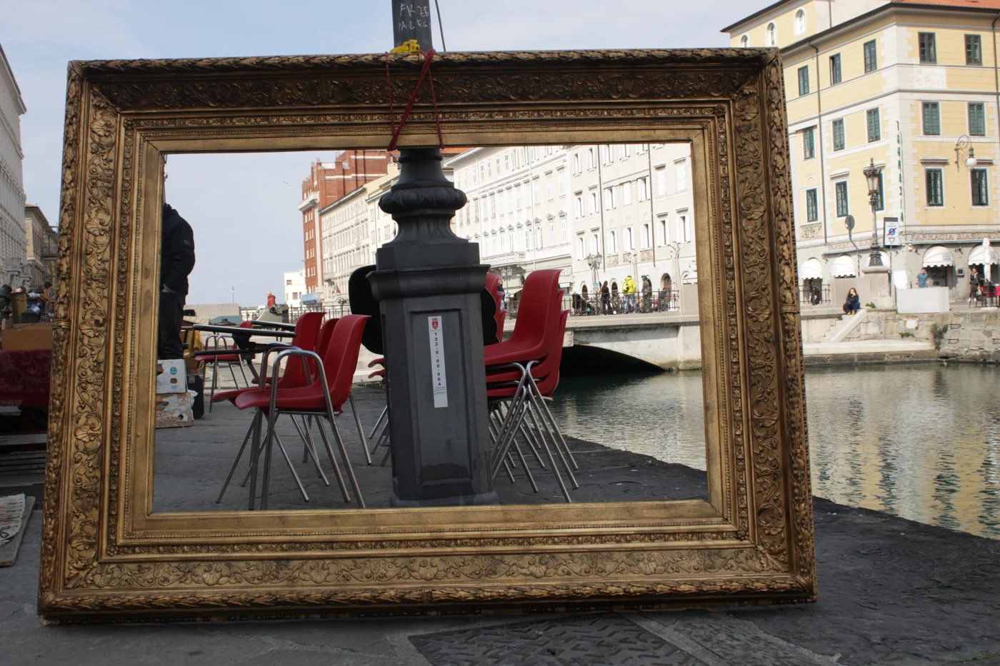
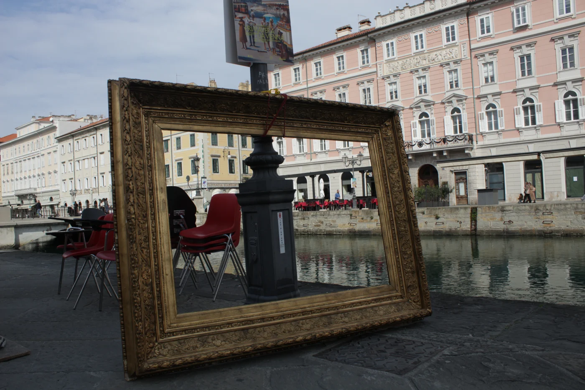

# Aprender mirando mis fotos

Un tutor para aprender con mis fotos y volver a salir con algo para practicar.

Quiero aprender foto. Tengo una cámara y empecé a sacar. Para mí, las lecciones teóricas vienen bien al principio, pero después hace falta sobre todo práctica y revisar lo que uno hizo.

Por eso es muy bueno salir a sacar con gente, que cada uno le dé al otro su perspectiva de qué onda la foto, cómo la hubiera hecho mejor, etcétera. Como todavía no tengo ese grupo, quería tener un asistente que me ayudara a revisar las fotos que saqué.

## El mismo marco, dos encuadres

Dos fotos propias de la misma serie. La revisión prefiere la primera por su orden, pero señala que el poste termina tapando lo que quería encuadrar.

## De la foto al ejercicio

Me interesa que pueda mirar una foto que saqué y conversar sobre la composición, lo que quería mostrar y las decisiones técnicas: obturador, diafragma, ISO. Pensar cómo podría haber sido mejor, cómo sacar del medio lo que distrae o cómo hacer más clara la búsqueda.

Y que además me ayude a entender qué conceptos me faltan para sacar mejores fotos y me proponga ejercicios para ir mejorando. Es como un asistente para aprender, como un profe o un tutor.

- **Antes de disparar:** Mirar detrás del sujeto y recorrer los cuatro bordes.
- **Antes de salir:** Revisar el ISO. Una prioridad técnica por vez.

## Las fotos ya están en la compu

Los archivos RAW conservan los ajustes con los que se tomó cada foto. Eso permite cruzar lo que se ve en la imagen con la información de la cámara y tener un punto de partida concreto para la conversación.

También me interesa que pueda acercar referencias de otras fotos que sirvan para inspirarse o entender una idea. La primera exploración trabaja con una serie de los Balcanes y una bitácora para volver sobre los conceptos en fotos nuevas.

Otra foto de la serie. Los arcos llevan la mirada hacia el fondo; el objeto rojo la trae de vuelta. Ese tipo de decisiones es lo que quiero poder conversar.

El proyecto todavía está inconcluso. Lo voy a ir mejorando mientras sigo sacando fotos y probando esa idea de un tutor personalizado para aprender.

[Leer en la web](https://tomasrene.com/experimentos/fotografia) · [Volver al catálogo](../README.md)
