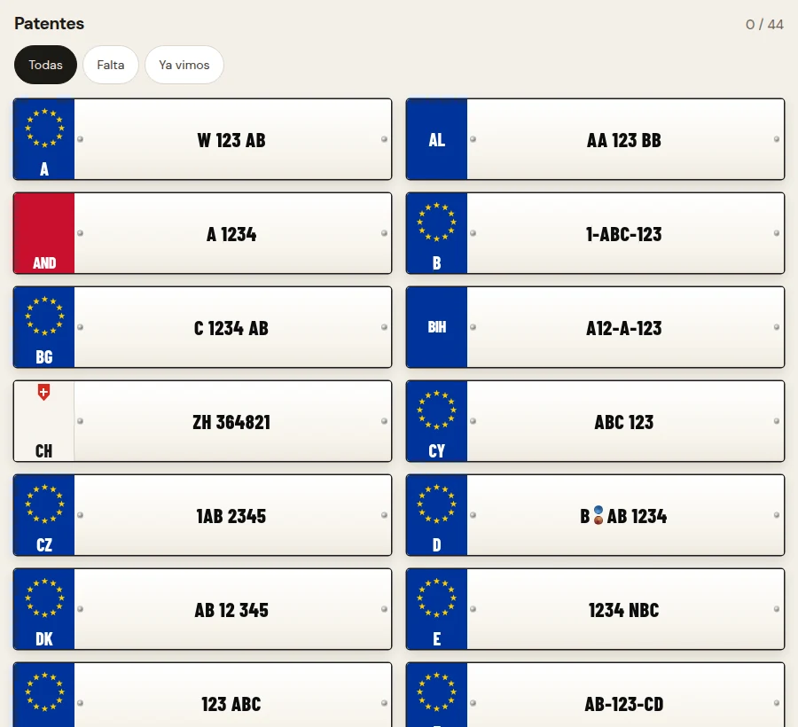

# Patentes

Un juego de viaje para ir coleccionando patentes europeas.

Cuando viajo por la ruta o por distintos países de Europa, hay un juego que se repite: ir mirando las patentes y preguntar “uh, ¿esta ya la vimos?”. Un día aparecieron más preguntas: qué tipos de patentes existen, cuáles serán las más raras, qué nombre e inicial tienen los distintos países.

Así que dije: “voy a armar un juego para ir coleccionando patentes”. Fue simplemente eso, una exploración divertida de un juego de viaje.

El álbum con progreso de ejemplo.

## Un álbum para la ruta

La app permite revelar el país de una patente, marcarla como vista y volver a las que faltan. Hay formatos, bandas y colores distintos; parte del juego es ir aprendiendo a reconocerlos.

Después me enteré de que hay toda una comunidad de cazadores de patentes.

[Leer en la web](https://tomasrene.com/experimentos/patentes) · [Volver al catálogo](../README.md)
