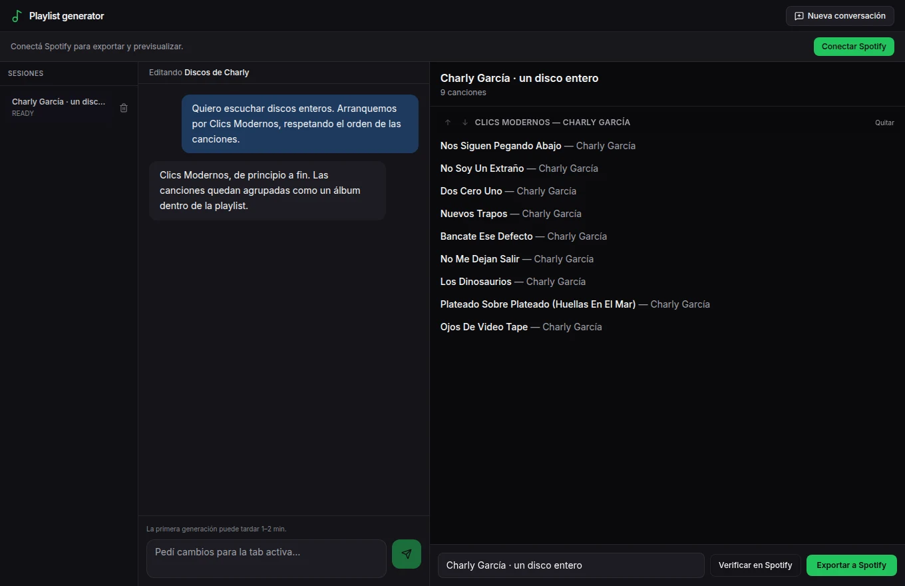

# Playlists de discos

Descubrir discos enteros, con su orden y su contexto.

Con Spotify y otras formas de escuchar música, siento que cada vez terminamos más en playlists de canciones sueltas. A mí me gusta mucho el álbum: un artista elige un orden, te lleva de una canción más arriba a otra más abajo y arma un recorrido.

Además, un disco nace en un momento. Tiene un contexto, conversa con otras músicas y tiene algo que decir en sus letras. Quería volver a escuchar así, y al mismo tiempo descubrir artistas y discos que no conocía.



La interfaz con un disco completo de ejemplo: Clics Modernos, de Charly García. Es una muestra preparada para esta página.

## Una playlist armada con álbumes

Hoy es fácil buscar música para un mood muy específico. Algo tipo “música chill para un asado de domingo a la tarde, con sol pero no tanto calor”. Mi idea era pedir una playlist así, pero compuesta por álbumes enteros de distintos artistas, respetando el orden de cada disco.

También me interesan pedidos como “los tres mejores discos de Charly”. Recorrer a un artista por sus obras, aunque haya algún tema que no me guste en el medio, en vez de terminar siempre en un “Greatest Hits” o un “This Is…”.

```python
raw_items = iter_album_track_items(sp, aid)
```

Un recorte del código que recupera las canciones del álbum desde Spotify para incorporarlo completo.

De ahí salió el armador de playlists. La versión local permite conversar sobre la selección, trabajar con varias propuestas y llevarlas a Spotify. Lo que quiero conservar en ese recorrido es el disco completo: sus canciones, su orden y la posibilidad de descubrir algo más que los temas conocidos.

[Leer en la web](https://tomasrene.com/experimentos/playlists) · [Volver al catálogo](../README.md)

[El disco del ejemplo en Spotify](https://open.spotify.com/album/3OyBf97NOuJjhEpQHY920H)
