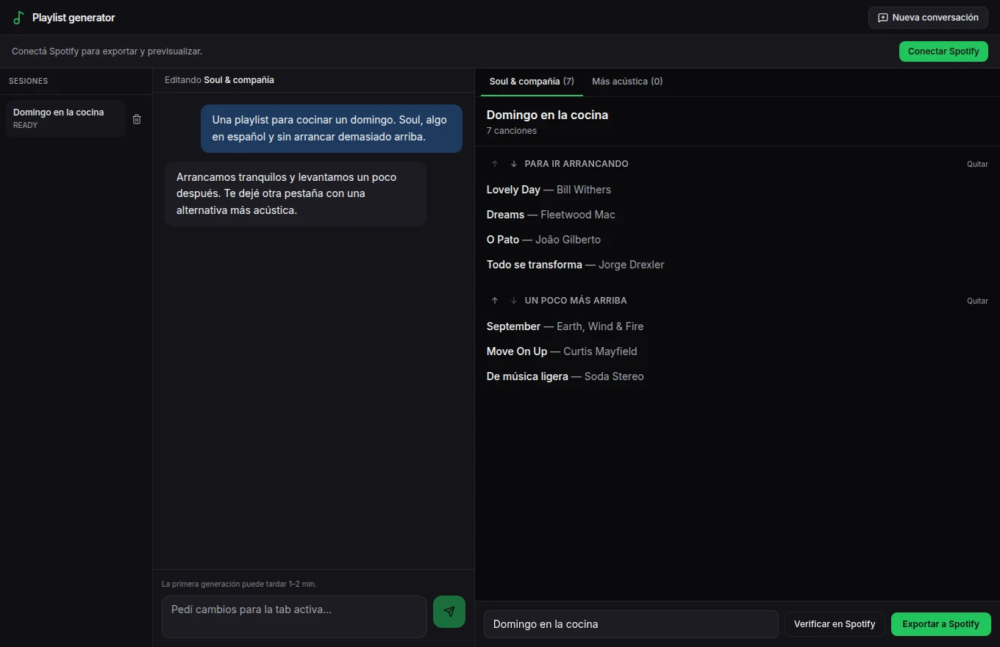

# Playlists conversadas

Pedir música con palabras e ir ajustando la selección.

Quería poder pedir una playlist como se la pediría a alguien: qué tengo ganas de escuchar, para qué momento y qué prefiero evitar. Y después poder decir “por acá sí, por acá no” sin empezar de cero.



La interfaz con una conversación y canciones de ejemplo.

## Una canción también tiene versiones

Hay una versión local con chat, varias playlists en pestañas, edición a mano y exportación a Spotify. La primera interfaz estaba hecha en Streamlit; después pasó a una app web con historial.

Una parte del trabajo está en encontrar las canciones. El nombre que propone un modelo no siempre alcanza para elegir una grabación concreta en Spotify.

```python
qs.append(f"{t} artist:{a}")
if raw and raw not in qs:
    qs.append(raw)
```

Recorte de playlist_resolver.py: primero busca título y artista; después prueba una búsqueda menos restrictiva.

Me interesa seguir por ese lado: que la conversación ayude a encontrar música, pero que cambiar una canción o corregir una selección siga siendo fácil.

[Leer en la web](https://tomasrene.com/experimentos/playlists) · [Volver al catálogo](../README.md)
