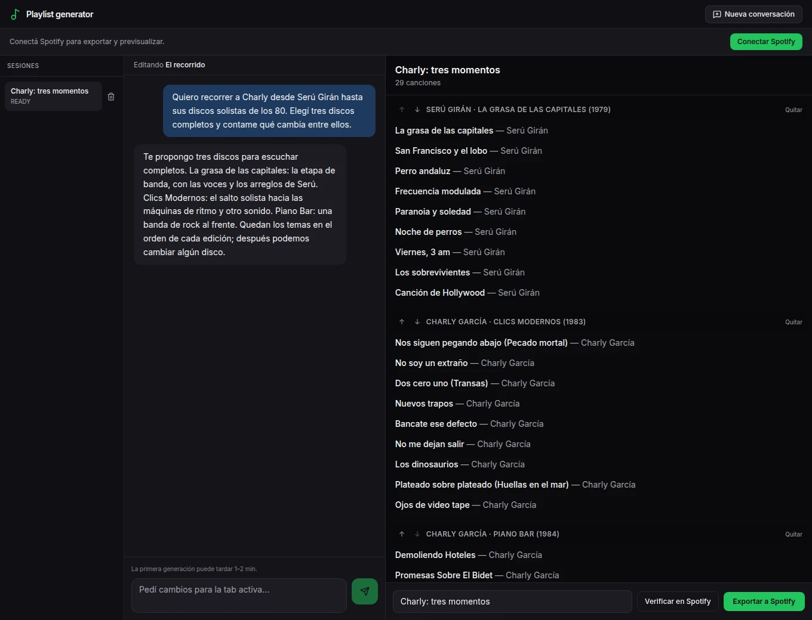

# Playlists de discos

Descubrir discos enteros, con su orden y su contexto.

A mí no me gusta nada que en la actualidad, con Spotify pero por otros fenómenos también, uno tienda a escuchar playlists fragmentadas. Se perdió el concepto del álbum. Y para mí el álbum tiene algo muy lindo: un artista elige un orden de canciones para ir llevándote por un mood, te pone una más arriba, otra más abajo.

Pero además un álbum nace en un contexto, en un momento determinado, discutiendo con ciertas tendencias, con un perfil de letras. Yo quería volver a escuchar álbumes, pero también poder descubrir discos y artistas que no conocía.

- **El pedido:** Quiero recorrer a Charly desde Serú Girán hasta sus discos solistas de los 80. Elegí tres discos completos y contame qué cambia entre ellos.
- **La selección de ejemplo:** Tres álbumes, con sus canciones en orden. Se puede conversar sobre el recorrido y cambiar la selección antes de llevarla a Spotify.

Recorrer etapas de un artista: La grasa de las capitales, Clics Modernos y Piano Bar. Conversación preparada para mostrar la interfaz; no es una respuesta generada en vivo.

## Playlists, pero de álbumes

Hoy, si buscás música de un mood determinado, es muy fácil en Spotify. Te arma una playlist de “música chill para un asado de un domingo a la tarde con sol pero no tanto calor”. Es un ejemplo, pero me hace gracia lo específicas que pueden ser.

Yo lo que quería era que me armara una playlist compuesta por álbumes de artistas. Poder descubrir música nueva, pero con su orden y contexto original. También recorrer los discos de una banda organizados por etapas, entendiendo qué fue cambiando.

Incluye exploraciones tipo “los tres mejores discos de Charly”, que también es algo que me gusta: ver a un artista por sus mejores obras, aunque tengan temas malos en el medio, sin estar siempre escuchando “The Greatest Hits” o “This Is…”.

La versión local permite conversar sobre las propuestas, cambiar la selección y llevarla a Spotify.

[Leer en la web](https://tomasrene.com/experimentos/playlists) · [Volver al catálogo](../README.md)
